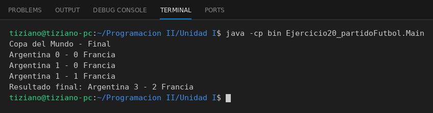

# PartidoFutbol

Programación II - Unidad 1 - Ejercicio 20

## Consigna
Representar un partido de fútbol en curso con los nombres de los equipos y los goles de cada uno.

## Lógica
- **Atributos (privados):** `equipoLocal`, `equipoVisitante` (String), `golesLocal` y `golesVisitante` (int).
- **Constructor:** recibe solo los nombres de los equipos y inicia ambos marcadores en cero.
- **`golLocal()` / `golVisitante()`:** incrementan en uno el marcador del equipo correspondiente.
- **`mostrarResultado()`:** imprime cómo va el partido con el formato `Local X - Y Visitante`.
- **`Main`:** simula una final de la Copa del Mundo entre Argentina y Francia, con anotaciones de ambos equipos hasta el 3 - 2 final.

## Ejecución

